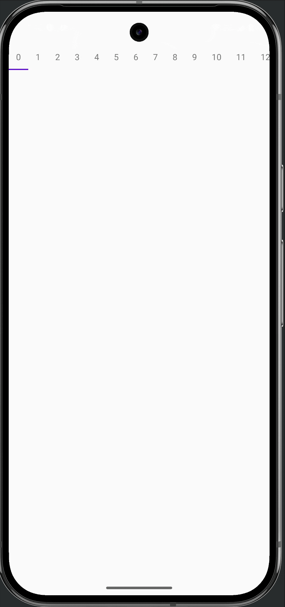

# irurueta-android-recycler-tab-layout

Implementation of a tab layout using a recycler view.

[](https://github.com/albertoirurueta/irurueta-android-recycler-tab-layout/actions/workflows/main.yml)
[](https://github.com/albertoirurueta/irurueta-android-recycler-tab-layout/actions/workflows/develop.yml)
[](https://github.com/albertoirurueta/irurueta-android-recycler-tab-layout/actions/workflows/security.yml)

[](https://sonarcloud.io/summary/new_code?id=albertoirurueta_irurueta-android-recycler-tab-layout)
[](https://sonarcloud.io/summary/new_code?id=albertoirurueta_irurueta-android-recycler-tab-layout)
[](https://sonarcloud.io/summary/new_code?id=albertoirurueta_irurueta-android-recycler-tab-layout)
[](https://sonarcloud.io/summary/new_code?id=albertoirurueta_irurueta-android-recycler-tab-layout)
[](https://sonarcloud.io/summary/new_code?id=albertoirurueta_irurueta-android-recycler-tab-layout)
[](https://sonarcloud.io/summary/new_code?id=albertoirurueta_irurueta-android-recycler-tab-layout)
[](https://sonarcloud.io/summary/new_code?id=albertoirurueta_irurueta-android-recycler-tab-layout)
[](https://sonarcloud.io/summary/new_code?id=albertoirurueta_irurueta-android-recycler-tab-layout)
[](https://sonarcloud.io/summary/new_code?id=albertoirurueta_irurueta-android-recycler-tab-layout)
[](https://sonarcloud.io/summary/new_code?id=albertoirurueta_irurueta-android-recycler-tab-layout)
[](https://sonarcloud.io/summary/new_code?id=albertoirurueta_irurueta-android-recycler-tab-layout)

[](https://central.sonatype.com/artifact/com.irurueta/irurueta-android-recycler-tab-layout)

## Project Status

| Item | Value |
| --- | --- |
| Language | Kotlin 2.4.21 (JVM target 17) |
| Build tool | Gradle 9.9.1 (Kotlin DSL) |
| Current development version | `1.1.12-SNAPSHOT` |
| Latest release | `1.1.11` |
| Platform | Android |
| Min / compile SDK | `minSdk` 26 (Android 8.0) / `compileSdk` 36 |
| Kotlin / AGP | Kotlin 2.4.21 / Android Gradle Plugin 9.5.1 |
| License | Apache License 2.0 |
| CI | GitHub Actions: `develop` builds (tests, Lint, SonarCloud, docs, snapshot publish), releases (Maven Central publish and GitHub Pages docs) and weekly security scans |
| Quality | SonarCloud, JaCoCo coverage, Android Lint |
| Distribution | Maven Central (`com.irurueta:irurueta-android-recycler-tab-layout`) |

## Documentation

- [Documentation site](https://albertoirurueta.github.io/irurueta-android-recycler-tab-layout/) (Antora): installation,
  usage, configuration reference and building instructions.
- [Usage page](docs/modules/ROOT/pages/usage.adoc) with complete examples (also published as the Usage page of the
  documentation site).
- [API documentation](https://albertoirurueta.github.io/irurueta-android-recycler-tab-layout/api/) (Dokka).
- [SonarCloud dashboard](https://sonarcloud.io/summary/new_code?id=albertoirurueta_irurueta-android-recycler-tab-layout).
- [Changelog](CHANGELOG.md).

## Overview

This library contains an implementation of a view similar in appearance to Android's
[TabLayout](https://developer.android.com/reference/com/google/android/material/tabs/TabLayout).

However, TabLayout implementation is not appropriate in situations where there are many items to be
displayed and each of those items contain complex or memory intensive views such as when attempting
to display image thumbnails in each tab.

This view attempts to solve this issue by using a RecyclerView to display such items and adding a
line indicator similar to the one used in TabLayout in order to obtain a similar behavior.



## Installation

The library is published to Maven Central. Make sure `mavenCentral()` is among your repositories and add the
dependency to your module's `build.gradle.kts`:

Latest release:

```kotlin
dependencies {
    implementation("com.irurueta:irurueta-android-recycler-tab-layout:1.1.11")
}
```

The Installation page of the [documentation site](https://albertoirurueta.github.io/irurueta-android-recycler-tab-layout/)
also covers other build script forms.

## Usage

`RecyclerTabLayout` extends `RecyclerView`, so it is added to your xml layout like any other view:

```xml
<com.irurueta.android.recyclertablayout.RecyclerTabLayout
    android:id="@+id/recycler_tab_layout"
    android:layout_width="match_parent"
    android:layout_height="48dp"
    app:tabIndicatorColor="?attr/colorPrimary"
    app:tabIndicatorHeight="2dp" />
```

The view sets up its own horizontal `LinearLayoutManager`; do not replace it, since the indicator relies on it to find
the selected tab.

Tabs are supplied through a regular `RecyclerView.Adapter`, for instance:

```kotlin
class TabViewHolder(val textView: TextView) : RecyclerView.ViewHolder(textView)

class TabAdapter(
    private val titles: List<String>,
    private val onTabClick: (position: Int) -> Unit
) : RecyclerView.Adapter<TabViewHolder>() {

    override fun onCreateViewHolder(parent: ViewGroup, viewType: Int): TabViewHolder {
        val density = parent.resources.displayMetrics.density
        val textView = TextView(parent.context)
        textView.gravity = Gravity.CENTER
        textView.minWidth = (72 * density).toInt()
        textView.layoutParams = RecyclerView.LayoutParams(
            ViewGroup.LayoutParams.WRAP_CONTENT,
            ViewGroup.LayoutParams.MATCH_PARENT
        )
        return TabViewHolder(textView)
    }

    override fun onBindViewHolder(holder: TabViewHolder, position: Int) {
        holder.textView.text = titles[position]
        holder.textView.setOnClickListener {
            val clickedPosition = holder.bindingAdapterPosition
            if (clickedPosition != RecyclerView.NO_POSITION) {
                onTabClick(clickedPosition)
            }
        }
    }

    override fun getItemCount(): Int = titles.size
}
```

Then set the adapter on the view (obtained with `findViewById<RecyclerTabLayout>(R.id.recycler_tab_layout)`):

```kotlin
// 10,000 tabs: only the visible tab views are created, and they are recycled on scroll
val titles = List(10_000) { "Tab $it" }
recyclerTabLayout.adapter = TabAdapter(titles) { position ->
    recyclerTabLayout.setCurrentItem(position)
}
```

The selected tab can be changed from code:

```kotlin
// scroll to tab 5 and animate the indicator towards it
recyclerTabLayout.setCurrentItem(5)

// select tab 5 immediately, without animation (for instance when restoring state)
recyclerTabLayout.setCurrentItem(5, smoothScroll = false)
```

And kept in sync with a `ViewPager2`:

```kotlin
// selecting a page selects the matching tab
viewPager.registerOnPageChangeCallback(object : ViewPager2.OnPageChangeCallback() {
    override fun onPageSelected(position: Int) {
        recyclerTabLayout.setCurrentItem(position)
    }
})

// clicking a tab shows the matching page
recyclerTabLayout.adapter = TabAdapter(titles) { position ->
    viewPager.currentItem = position
}
```

See the [Usage page](docs/modules/ROOT/pages/usage.adoc) of the documentation site for full examples (creating the view in code, automatic selection while scrolling and
indicator customization), and the Configuration page for every xml attribute and its default value.

## Contributing

This repository follows a gitflow branching model:

- `develop` is the integration branch: feature and fix branches are opened against it, and every push builds,
  tests and publishes a `-SNAPSHOT` version.
- `main` holds releases: publishing a GitHub release from `main` deploys the library to Maven Central and the
  documentation to GitHub Pages, after which the release is merged back into `develop`.

Notable changes for each version are listed in the [Changelog](CHANGELOG.md).

## License

This project is licensed under the Apache License 2.0. See [LICENSE](LICENSE).
